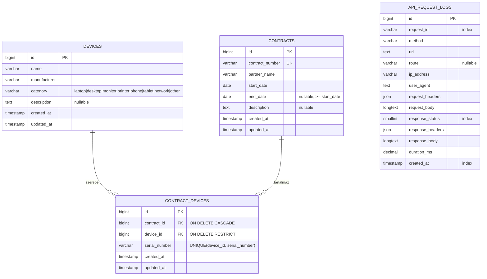
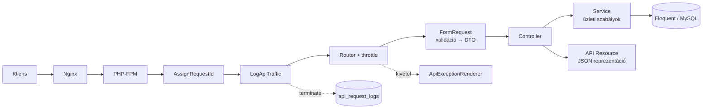

# Eszköznyilvántartó REST API – tervezési dokumentum

Ez a dokumentum rögzíti a feladat értelmezését, a tervezési döntéseket és azok indoklását,
valamint a megvalósítás lépéseit. A kód, az API-üzenetek és az OpenAPI leírás angol nyelvű
(iparági konvenció), a projektdokumentáció magyar.

---

## 1. Követelmények → megoldás

| #  | Követelmény | Megoldás |
|----|-------------|----------|
| F1 | Eszköz létrehozása, módosítása, törlése, lekérdezése (lista + egy elem) | `/api/v1/devices` erőforrás |
| F2 | Szerződés létrehozása, módosítása, törlése, lekérdezése (lista + egy elem) | `/api/v1/contracts` erőforrás |
| F3 | Szerződés lekérdezésekor a rajta lévő eszközök megjelennek, a listában nem | `ContractResource` a `devices` kulcsot csak betöltött kapcsolatnál adja vissza (`whenLoaded`); csak a `show` tölti be eager loadinggal |
| F4 | Eszköz hozzáadása / levétele szerződésről | `POST /api/v1/contracts/{contract}/devices`, `DELETE /api/v1/contracts/{contract}/devices/{contractDevice}` |
| K1 | CRUD REST API | erőforrás-orientált URL-ek, helyes HTTP igék és státuszkódok (200/201/204/404/409/422) |
| K2 | Egységes hibakezelés | központi `ApiExceptionRenderer`, minden hiba ugyanabban a JSON formátumban, gépi hibakóddal és `request_id`-val |
| K3 | Request/response naplózás adatbázisba | globális `LogApiTraffic` middleware → `api_request_logs` tábla (érzékeny adatok maszkolva) |
| K4 | OpenAPI dokumentáció publikus URL-en, Basic Auth-tal | Scramble: OpenAPI 3.1 a kódból generálva, UI: `/docs/api`, JSON: `/docs/api.json`, saját Basic Auth middleware |
| T1 | Laravel 13 | `laravel/framework` 13.x |
| T2 | Támogatott PHP, lehetőleg 8.5 | `php:8.5-fpm-alpine` Docker image |
| T3 | MySQL | MySQL 8.4 LTS |
| T4 | Clean code (SOLID, DRY) | rétegzett felépítés, lásd [6. fejezet](#6-architektúra) |
| T5 | PSR-4, PSR-12 | Composer PSR-4 autoload (`dump-autoload --strict-psr`), Pint `psr12` preset + PHP_CodeSniffer `PSR12` ellenőrzés |
| T6 | Docker csomag | `docker-compose.yaml`: `app` (PHP-FPM), `web` (Nginx), `mysql` |
| T7 | Migrációkból felállítható | `php artisan migrate --seed` (a séma kizárólag migrációkból épül) |

---

## 2. A domain értelmezése és feltételezések

> „Egy eszköztípus több szerződésen is rajta lehet, viszont eszközönként más gyári számmal. (N:N)”

- **Eszköz (`Device`)** – eszköztípus / katalóguselem, pl. *Dell Latitude 5540* (gyártó: Dell,
  kategória: laptop). Önmagában nem fizikai példány.
- **Szerződés (`Contract`)** – szerződésszám, partner, hatály (kezdet, opcionális vége), leírás.
- **Szerződés-eszköz (`ContractDevice`)** – az N:N kapcsolat *asszociációs entitása*: egy konkrét
  fizikai eszköz a szerződésen, saját **gyári számmal**. Azért önálló entitás (saját `id`-val),
  mert a kapcsolatnak saját attribútuma (gyári szám) és saját életciklusa (hozzáadás/levétel) van.

**Feltételezések** (a feladatleírás alapján, egyeztethetők):

1. Ugyanaz az eszköztípus több szerződésen is szerepelhet, és egy szerződésen akár többször is
   (pl. 10 db azonos laptop) – de minden példány más gyári számmal.
2. A gyári szám **eszköztípuson belül egyedi** (`UNIQUE(device_id, serial_number)`), vagyis egy
   fizikai eszköz egyszerre csak egy szerződésen lehet. Eltérő típusoknál (más gyártó) ugyanaz a
   gyári szám előfordulhat.
3. Eszköztípus nem törölhető, amíg szerződéshez van rendelve → `409 device_in_use`
   (adatbázis szinten `ON DELETE RESTRICT` is védi).
4. Szerződés törlésekor a tételei (hozzárendelések) is törlődnek (`ON DELETE CASCADE`) – a tétel a
   szerződés része; az eszköztípusok megmaradnak.
5. A levétel a hozzárendelés azonosítójával történik (a szerződés részleteiben `devices[].id`),
   mert ugyanaz a típus többször is szerepelhet egy szerződésen.
6. Módosítás `PUT`-tal, teljes reprezentációval (az opcionális mezők elhagyása `null`-t jelent).
   Részleges módosítás (`PATCH`) nem része a feladatnak → `405`.
7. Az API-hoz a feladat nem kér authentikációt, ezért nyitott; a dokumentáció Basic Auth-tal
   védett. (Éles környezetben tokenes auth – pl. Laravel Sanctum – kerülne elé.)
8. Fizikai törlés (nincs soft delete), mert a feladat törlést kér. Audit igény esetén soft
   delete-re vagy eseménynaplóra bővíthető.

---

## 3. Adatmodell



- Az eszköz kategóriája PHP backed enum (`DeviceCategory`), az adatbázisban string, a validáció
  `Rule::enum()`-mal történik, és az OpenAPI dokumentációban felsorolásként jelenik meg.
- Az `api_request_logs` csak hozzáfűzhető napló (nincs `updated_at`), a régi bejegyzések a
  `MassPrunable` trait-tel takaríthatók (`php artisan model:prune`, megőrzési idő konfigurálható).

---

## 4. API végpontok

Alap URL: `http://localhost:8080/api/v1`

| Metódus  | URL | Leírás | Siker |
|----------|-----|--------|-------|
| `GET`    | `/devices` | Eszközök listája (lapozott) | 200 |
| `POST`   | `/devices` | Eszköz létrehozása | 201 + `Location` |
| `GET`    | `/devices/{device}` | Egy eszköz | 200 |
| `PUT`    | `/devices/{device}` | Eszköz módosítása | 200 |
| `DELETE` | `/devices/{device}` | Eszköz törlése (ha nincs szerződésen) | 204 |
| `GET`    | `/contracts` | Szerződések listája (lapozott, **eszközök nélkül**) | 200 |
| `POST`   | `/contracts` | Szerződés létrehozása | 201 + `Location` |
| `GET`    | `/contracts/{contract}` | Egy szerződés **a rajta lévő eszközökkel** | 200 |
| `PUT`    | `/contracts/{contract}` | Szerződés módosítása | 200 |
| `DELETE` | `/contracts/{contract}` | Szerződés törlése (a tételeivel együtt) | 204 |
| `POST`   | `/contracts/{contract}/devices` | Eszköz hozzáadása gyári számmal | 201 |
| `DELETE` | `/contracts/{contract}/devices/{contractDevice}` | Eszköz levétele a szerződésről | 204 |

- Lista paraméterek: `page` (≥ 1), `per_page` (1–100, alapértelmezett 15).
- A `{contractDevice}` *scoped binding*: csak az adott szerződéshez tartozó tétel oldható fel,
  más szerződés tétele `404`.
- Válaszburok: `{"data": …}`; listánál emellett `links` és `meta` (lapozás).
- Verziózás az URL-ben (`/v1`), rate limit: alapértelmezetten 120 kérés / perc / IP.

Példa – `GET /api/v1/contracts/1`:

```json
{
  "data": {
    "id": 1,
    "contract_number": "SZ-2026/001",
    "partner_name": "Példa Kft.",
    "start_date": "2026-01-01",
    "end_date": "2026-12-31",
    "description": "Irodai eszközök bérlése",
    "devices": [
      {
        "id": 7,
        "contract_id": 1,
        "serial_number": "5CD1234XYZ",
        "device": {
          "id": 3,
          "name": "Latitude 5540",
          "manufacturer": "Dell",
          "category": "laptop",
          "description": null,
          "created_at": "2026-11-05T10:00:00Z",
          "updated_at": "2026-11-05T10:00:00Z"
        },
        "assigned_at": "2026-11-05T10:05:00Z"
      }
    ],
    "created_at": "2026-11-05T10:00:00Z",
    "updated_at": "2026-11-05T10:00:00Z"
  }
}
```

---

## 5. Egységes hibakezelés

Minden `api/*` alatti hiba – a `Accept` fejléctől függetlenül – ugyanabban a formátumban tér vissza:

```json
{
  "message": "The given data was invalid.",
  "code": "validation_failed",
  "errors": { "serial_number": ["The serial number has already been taken."] },
  "request_id": "0193a6f2-6c1e-7d0b-9f5e-2b1c4d7e8a90"
}
```

- `message` – ember által olvasható üzenet; `5xx` esetén soha nem szivárogtat belső részletet.
- `code` – stabil, gépi feldolgozásra szánt hibakód (`ErrorCode` enum, egy helyen definiálva).
- `errors` – csak validációs hibánál, mezőnkénti üzenetekkel.
- `request_id` – a kérés azonosítója; ugyanez szerepel az `X-Request-Id` válaszfejlécben és az
  `api_request_logs` táblában, így egy hibajelzés azonnal visszakereshető.
- `debug` – csak `APP_DEBUG=true` mellett (kivétel osztálya, üzenete, helye).

| HTTP | `code` | Mikor |
|------|--------|-------|
| 404 | `resource_not_found` | nem létező erőforrás (route model binding) |
| 404 | `route_not_found` | nem létező végpont |
| 405 | `method_not_allowed` | nem támogatott HTTP ige (`Allow` fejléccel) |
| 409 | `device_in_use` | szerződéshez rendelt eszköz törlése |
| 409 | `serial_number_already_assigned` | gyári szám ütközés párhuzamos kéréseknél (DB unique constraint) |
| 409 | `conflict` | egyéb egyediségi ütközés adatbázis szinten |
| 422 | `validation_failed` | validációs hiba |
| 429 | `too_many_requests` | rate limit túllépés (`Retry-After` fejléccel) |
| 4xx | `bad_request`, `unauthenticated`, `forbidden`, `http_error` | egyéb HTTP hibák |
| 500 | `internal_server_error` | váratlan hiba (naplózva) |
| 503 | `service_unavailable` | karbantartási mód |

**Megvalósítás:**

- `bootstrap/app.php` → `withExceptions()`: az `api/*` útvonalakon minden kivétel a
  `ApiExceptionRenderer`-hez kerül.
- A framework kivételeit (validáció, not found, method not allowed, throttle, unique constraint
  violation) a renderer egy helyen képezi le.
- Saját üzleti hibák: az absztrakt `ApiException` leszármazottai (`DeviceInUseException`,
  `SerialNumberAlreadyAssignedException`), amelyek maguk adják meg a státuszkódot és a hibakódot →
  új üzleti hiba felvétele nem igényli a renderer módosítását (Open/Closed).
- Az üzleti (`ApiException`) hibák nem kerülnek az error logba (`dontReport`), a váratlan `5xx`
  hibák igen.

---

## 6. Architektúra

### Kérés útja



### Könyvtárszerkezet

```
app/
├── Data/                  # immutable DTO-k (readonly class): DeviceData, ContractData, ContractDeviceData
├── Enums/                 # DeviceCategory, ErrorCode
├── Exceptions/            # ApiException + üzleti kivételek, ApiExceptionRenderer
├── Http/
│   ├── Controllers/Api/V1 # vékony controllerek
│   ├── Middleware/        # AssignRequestId, LogApiTraffic, AuthenticateDocs
│   ├── Requests/          # validáció + DTO előállítás (toData)
│   └── Resources/         # JSON reprezentáció
├── Logging/ApiTraffic/    # naplózás: rekord-DTO, factory, logger interfész + DB implementáció, maszkoló
├── Models/                # Device, Contract, ContractDevice, ApiRequestLog
├── OpenApi/               # Scramble kiterjesztés: a hibaformátum dokumentálása
├── Providers/             # konténer kötések, rate limiter
└── Services/              # DeviceService, ContractService, ContractDeviceService
```

### Rétegek felelőssége (SRP)

| Réteg | Felelősség | Nem felelőssége |
|-------|------------|-----------------|
| Controller | HTTP ↔ alkalmazás fordítás, státuszkód | validáció, üzleti szabály, lekérdezés-építés |
| FormRequest | bemenet validálása, típusos DTO előállítása | perzisztencia |
| DTO (`Data`) | típusos, megváltoztathatatlan adatátadás a rétegek között | logika |
| Service | use case-ek, üzleti szabályok (pl. foglalt eszköz nem törölhető), kivételek | HTTP |
| Model | séma-leképezés, kapcsolatok, castok | üzleti folyamat |
| Resource | kimeneti reprezentáció (pl. eszközök csak részletes nézetben) | adatlekérés |
| Middleware | keresztmetszeti feladatok (request id, naplózás, docs auth) | domain logika |

### SOLID és DRY a gyakorlatban

- **S** – lásd a fenti táblázat; a naplózás is szét van bontva (adatkinyerés, maszkolás, tárolás).
- **O** – új üzleti hiba = új `ApiException` leszármazott, a renderer változatlan; új naplózási
  cél = új `ApiTrafficLogger` implementáció, a middleware változatlan.
- **L** – bármely `ApiException` leszármazott és bármely `ApiTrafficLogger` implementáció
  felcserélhető a hívó oldal módosítása nélkül.
- **I** – kicsi, egycélú interfész (`ApiTrafficLogger::log()`).
- **D** – a middleware az `ApiTrafficLogger` absztrakciótól függ (kötés a service providerben),
  a függőségek konstruktor injektálással érkeznek.
- **DRY** – egy FormRequest szolgálja ki a létrehozást és a módosítást (a `unique` szabály
  `ignore()`-ja létrehozáskor no-op); közös lapozási request; a `DeviceResource` újrahasznosítva
  a szerződés tételeiben; egyetlen hibarenderelő; hibakódok egy enumban; az OpenAPI leírás a
  kódból generálódik (nincs duplikált annotáció).

### Miért nincs repository réteg?

Az Eloquent már maga is absztrakció a perzisztencia felett. CRUD jellegű feladatnál egy
repository interfész + implementáció pár főleg továbbító (boilerplate) kódot jelentene, a route
model binding pedig úgyis megkerülné. Az üzleti logika varratpontja (seam) a service réteg; DIP
ott van alkalmazva, ahol valódi variációs pont van (naplózás célja). Ha később több adatforrás
vagy összetett lekérdezés jelenik meg, a service-ek mögé bevezethető anélkül, hogy a
controllereket érintené.

---

## 7. API forgalom naplózása

- **Globális middleware** (`LogApiTraffic`), konfigurálható útvonalmintával (`api/*`) – így a nem
  létező végpontokra érkező (`404`) és a rossz igével érkező (`405`) kérések is naplózódnak, a
  dokumentáció oldalai viszont nem.
- Az írás a `terminate()` fázisban történik, a válasz elküldése után (PHP-FPM
  `fastcgi_finish_request`), így nem lassítja a klienst; az időmérés a `handle()`-ben történik.
- A naplózás hibája soha nem töri el a kérést (elkapjuk és a Laravel logba írjuk).
- Naplózott adatok: request id, metódus, URL, route minta, IP, user agent, request fejlécek és
  törzs, response státusz, fejlécek és törzs, futási idő (ms).
- **Érzékeny adatok maszkolása** (konfigurálható kulcslista, kis/nagybetű-független, rekurzív):
  `authorization`, `cookie`, `password`, `token`, … → `********`.
- A törzsek mérete korlátozott (`max_body_length`), a nyers (még nem trimmelt) request törzs
  kerül mentésre.
- A tárolás az `ApiTrafficLogger` interfész mögött van (`DatabaseApiTrafficLogger`), így
  nagy forgalomnál egyszerűen cserélhető queue-alapú megoldásra.

---

## 8. OpenAPI dokumentáció

- **Scramble** (`dedoc/scramble`): az OpenAPI 3.1 leírás a FormRequest szabályokból, a Resource
  osztályokból, a route-okból és a PHPDoc megjegyzésekből generálódik, így mindig szinkronban van a
  kóddal (DRY – nincs kézzel karbantartott, elavuló annotáció).
- UI (Stoplight Elements, „Try it” funkcióval): `http://localhost:8080/docs/api`,
  nyers specifikáció: `http://localhost:8080/docs/api.json`.
- **Basic Auth**: saját `AuthenticateDocs` middleware, a hitelesítő adatok `.env`-ből
  (`API_DOCS_USERNAME`, `API_DOCS_PASSWORD`), időzítés-biztos összehasonlítás (`hash_equals`),
  és ha nincs beállítva hitelesítő adat, a hozzáférés tiltott (fail-closed).
- Az egységes hibaformátum és a hibakódok szintén megjelennek a dokumentációban: egy saját
  Scramble kiterjesztés (`App\OpenApi\ApiErrorResponseExtension`) a Laravel alapértelmezett
  hibaformátuma helyett a valódit dokumentálja, az üzleti kivételek státuszával és kódjával.
- A generált specifikáció exportálva is bekerül a repóba (`docs/openapi.json`), hogy futtatás
  nélkül is áttekinthető legyen.
- „Publikus URL”: a dokumentáció az alkalmazás egy nyilvános (bejelentkezés nélküli) útvonalán
  érhető el, Basic Auth mögött. Internetről elérhető példányhoz az alkalmazást egy szerverre kell
  telepíteni (pl. VPS + ugyanez a Docker Compose).

---

## 9. Docker környezet

| Szolgáltatás | Image | Szerep |
|--------------|-------|--------|
| `app` | `php:8.5-fpm-alpine` (saját Dockerfile: `pdo_mysql`, `intl`, `zip`, Composer) | Laravel, PHP-FPM, nem root felhasználóval |
| `web` | `nginx:1.29-alpine` | HTTP a `8080`-as porton, PHP kérések továbbítása az `app`-nak |
| `mysql` | `mysql:8.4` | adatbázis healthcheckkel; init script létrehozza a teszt adatbázist |

Indítás (részletesen a README-ben):

```bash
cp .env.example .env
docker compose up -d --build
docker compose exec app composer install
docker compose exec app php artisan key:generate
docker compose exec app php artisan migrate --seed
```

A `Makefile` ugyanezt egy paranccsal is elvégzi (`make setup`), valamint `make test`, `make lint`,
`make analyse` célokat ad.

---

## 10. Minőségbiztosítás

- **Tesztek** (PHPUnit, külön MySQL teszt adatbázison, `RefreshDatabase`):
  - Feature: eszköz CRUD, szerződés CRUD (lista eszközök nélkül, részletek eszközökkel),
    hozzáadás/levétel (gyári szám szabályok, scoped binding), hibaformátum (404/405/422/409/500),
    request id, naplózás (maszkolás, 404 naplózása, docs nem naplózódik), docs Basic Auth.
  - Unit: érzékenyadat-maszkoló, hibarenderelő leképezések.
- **Statikus analízis**: Larastan (PHPStan) `max` szinten, a tesztekre is.
- **Kódstílus**: Pint `psr12` preset (javítás) + PHP_CodeSniffer `PSR12` (ellenőrzés);
  minden saját fájl `declare(strict_types=1)`.
- **PSR-4**: `composer dump-autoload --strict-psr` – hibát dob, ha egy osztály nem PSR-4 szerint
  helyezkedik el.
- **CI**: GitHub Actions – composer validate, PSR-4, Pint, PHPCS, PHPStan, tesztek MySQL
  service konténerrel.

---

## 11. Megvalósítási lépések

1. Laravel 13 projekt létrehozása PHP 8.5 konténerben, felesleges frontend scaffolding (Vite,
   welcome oldal) és nem használt felhasználó-kezelés eltávolítása; Docker környezet.
2. Domain: migrációk, modellek, enumok, factoryk, seeder (valósághű demó adatok).
3. REST API: FormRequestek + DTO-k, service-ek, vékony controllerek, API Resource-ok, route-ok
   (`/api/v1`, scoped binding, rate limit).
4. Egységes hibakezelés + `X-Request-Id`.
5. API forgalom naplózása adatbázisba.
6. OpenAPI dokumentáció (Scramble) Basic Auth mögött, export `docs/openapi.json`-ba.
7. Tesztek, Larastan, Pint/PHPCS, CI workflow.
8. README (telepítés, használat, curl példák), végső ellenőrzés tiszta Docker környezetben
   (`migrate:fresh --seed`, teljes tesztkészlet).

---

## 12. Továbbfejlesztési lehetőségek

- Authentikáció/jogosultság (Sanctum + policy-k).
- Szűrés, keresés, rendezés a listákon (pl. partner, lejárat szerint).
- Soft delete és audit napló az eszköz–szerződés hozzárendelések történetére.
- Szerződés státusz (pl. lejárt szerződésre ne lehessen eszközt rendelni).
- Queue-alapú forgalomnaplózás nagy terhelésnél, naplók lekérdező végpontja.
- Részleges módosítás (`PATCH`) támogatása.
