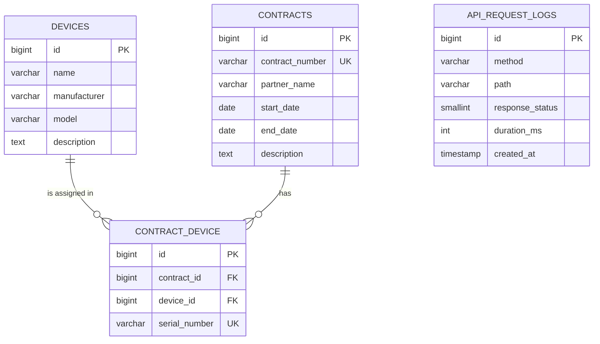

# Asset Registry API – eszköznyilvántartó REST API

Felület nélküli REST API szerződések és eszközök nyilvántartására. Egy eszköz (eszköztípus, pl. *Dell Latitude 5440*)
több szerződésen is szerepelhet, szerződésenként a konkrét példány gyári számával (N:N kapcsolat).

**Technológiák:** Laravel 13 · PHP 8.5 · MySQL 8.4 · nginx · Docker Compose ·
[Scramble](https://scramble.dedoc.co) (OpenAPI 3.1) · PHPUnit 12 · Larastan · Pint · PHP_CodeSniffer

## Funkciók

- Eszközök (eszköztípusok) létrehozása, módosítása, törlése, listázása és lekérdezése.
- Szerződések létrehozása, módosítása, törlése, listázása és lekérdezése; egy szerződés lekérdezése a rajta lévő
  eszközöket is visszaadja, a lista nem.
- Eszköz felvétele szerződésre gyári számmal, illetve levétele; a gyári szám a teljes rendszerben egyedi.
- Egységes hibaformátum minden hibára: [RFC 9457](https://www.rfc-editor.org/rfc/rfc9457) Problem Details.
- A teljes API-forgalom (kérés és válasz) naplózása MySQL-be, a titkok maszkolásával.
- OpenAPI-dokumentáció böngészhető felülettel, HTTP Basic Auth védelemmel.

## Gyors indítás

**Előfeltétel:** Docker (Compose v2-vel) és `make`. Helyi PHP, Composer és MySQL nem kell, minden konténerben fut.

```bash
git clone <repo-url> asset-registry-api
cd asset-registry-api
make up
```

A `make up` létrehozza a `.env`-et a `.env.example`-ből, felépíti az image-et, és elindítja a szolgáltatásokat. Az
`app` konténer induláskor lefuttatja a `composer install`-t, generál alkalmazáskulcsot, és **a migrációkból
felépíti az adatbázist**. A parancs akkor tér vissza, amikor minden szolgáltatás egészséges.

| Mi | Cím |
|----|-----|
| API | <http://localhost:8080/api/v1> |
| Dokumentáció (UI) | <http://localhost:8080/docs/api> – Basic Auth: `docs` / `docs-secret` |
| OpenAPI JSON | <http://localhost:8080/docs/api.json> |
| Health check | <http://localhost:8080/up> |

A dokumentáció hitelesítési adatai a `.env` `API_DOCS_USERNAME` és `API_DOCS_PASSWORD` változói; ha bármelyik üres,
a dokumentáció senkit nem enged be. A fenti értékek csak helyi fejlesztésre valók.

Demo adatok (6 eszköz, 3 szerződés, 7 hozzárendelés; a seeder újrafuttatható):

```bash
make seed
```

`make` nélkül ugyanez:

```bash
cp .env.example .env
docker compose up -d --build --wait
docker compose exec app php artisan db:seed
```

Az `app` konténer a hoszt felhasználójának UID/GID-jével fut, hogy a bind mountolt fájlok (`vendor/`, `storage/`,
`.env`) a hoszton is írhatók maradjanak. A Makefile ezt automatikusan beállítja. Ha Linuxon közvetlenül a
`docker compose`-t használod, és a felhasználód UID/GID-je nem 1000, add meg:
`HOST_UID=$(id -u) HOST_GID=$(id -g) docker compose up -d --build --wait`.

### Make-parancsok

| Parancs | Leírás |
|---------|--------|
| `make up` | Image-építés és indítás; megvárja, amíg minden szolgáltatás egészséges |
| `make down` | Leállítás (az adatbázis volume megmarad) |
| `make logs` | A szolgáltatások naplójának követése |
| `make shell` | Shell az `app` konténerben |
| `make migrate` | Migrációk futtatása |
| `make seed` | Demo adatok betöltése |
| `make fresh` | Az adatbázis újraépítése a migrációkból, demo adatokkal |
| `make test` | PHPUnit-tesztek |
| `make lint` | Kódstílus-ellenőrzés (Pint PSR-12 presettel, PHP_CodeSniffer PSR12) |
| `make fix` | Kódstílus javítása Pinttel |
| `make analyse` | Statikus elemzés (Larastan, max szint) |
| `make check` | A teljes minőségkapu: `lint`, `analyse`, `test` |

### Konfiguráció

A `.env.example` az összes változót tartalmazza, kommentekkel. A projektre jellemzők:

| Változó | Alapérték | Jelentés |
|---------|-----------|----------|
| `APP_PORT` | `8080` | A hoszton publikált HTTP-port |
| `DB_DATABASE`, `DB_USERNAME`, `DB_PASSWORD` | `asset_registry`, `asset_registry`, `secret` | MySQL-adatbázis és -felhasználó |
| `DB_FORWARD_PORT` | `33060` | A MySQL a hoszton, csak a `127.0.0.1` címen (pl. adatbázis-klienshez) |
| `API_DOCS_USERNAME`, `API_DOCS_PASSWORD` | `docs`, `docs-secret` | A dokumentáció Basic Auth adatai |
| `API_LOG_ENABLED` | `true` | Az API-forgalom naplózása |
| `API_LOG_MAX_BODY_BYTES` | `65536` | E fölött a naplózott törzsek csonkolódnak |

## API

Minden végpont a `/api/v1` előtag alatt van, JSON-t fogad és ad vissza, és hitelesítés nélkül hívható (a feladat
csak a dokumentáció védelmét kéri). A részletes leírás, kérés- és válaszsémákkal, a `/docs/api` alatt érhető el.

### Végpontok

| Metódus | Útvonal | Leírás |
|---------|---------|--------|
| `GET` | `/api/v1/devices` | Eszközök lapozott listája |
| `POST` | `/api/v1/devices` | Eszköz létrehozása |
| `GET` | `/api/v1/devices/{device}` | Egy eszköz |
| `PUT`, `PATCH` | `/api/v1/devices/{device}` | Eszköz módosítása (teljes, illetve részleges) |
| `DELETE` | `/api/v1/devices/{device}` | Eszköz törlése; szerződésen lévő eszköznél 409 |
| `GET` | `/api/v1/contracts` | Szerződések lapozott listája (eszközök nélkül) |
| `POST` | `/api/v1/contracts` | Szerződés létrehozása |
| `GET` | `/api/v1/contracts/{contract}` | Egy szerződés a rajta lévő eszközökkel és gyári számaikkal |
| `PUT`, `PATCH` | `/api/v1/contracts/{contract}` | Szerződés módosítása (teljes, illetve részleges) |
| `DELETE` | `/api/v1/contracts/{contract}` | Szerződés törlése; a hozzárendelései is törlődnek, az eszközök nem |
| `POST` | `/api/v1/contracts/{contract}/devices` | Eszköz felvétele a szerződésre (`device_id`, `serial_number`) |
| `DELETE` | `/api/v1/contracts/{contract}/devices/{device}` | Eszköz levétele a szerződésről |

### Adatok

| Erőforrás | Mezők |
|-----------|-------|
| Eszköz | `name`, `manufacturer`, `model` (kötelezők, legfeljebb 255 karakter), `description` (opcionális, legfeljebb 5000) |
| Szerződés | `contract_number` (kötelező, egyedi, legfeljebb 50), `partner_name` (kötelező), `start_date` (kötelező, `YYYY-MM-DD`), `end_date` (opcionális, nem lehet korábbi a kezdetnél), `description` (opcionális) |
| Felvétel szerződésre | `device_id` (létező eszköz azonosítója, JSON egész szám), `serial_number` (kötelező, legfeljebb 100 karakter, rendszerszinten egyedi) |

Szabályok:

- Egy eszköztípus akárhány szerződésen szerepelhet, de egy szerződésen legfeljebb egyszer.
- A gyári szám és a szerződésszám egyedisége kis- és nagybetű-érzéketlen; a szövegek elejéről és végéről a szóközök
  levágódnak.
- Szerződéshez rendelt eszköz nem törölhető (409); előbb le kell venni a szerződésekről.
- Az útvonalakban az azonosítók csak számok lehetnek; minden más 404 (a hibás kódolású URL 400, lásd a
  hibatáblát).
- A válaszokban a dátumok `YYYY-MM-DD`, az időbélyegek ISO 8601 formátumúak (UTC); a szerződés eszközeinél az
  `attached_at` a felvétel ideje.

### Példák

A példák üres adatbázist feltételeznek. Seedelt adatbázisban az azonosítók eltérnek: ott például a demo 1-es
szerződésén már rajta van az 1-es eszköz, így a felvétele 409-et adna.

```bash
# Eszköz (típus) létrehozása
curl -s -X POST http://localhost:8080/api/v1/devices \
  -H 'Content-Type: application/json' \
  -d '{"name": "Dell Latitude 5440", "manufacturer": "Dell", "model": "Latitude 5440"}'

# Szerződés létrehozása
curl -s -X POST http://localhost:8080/api/v1/contracts \
  -H 'Content-Type: application/json' \
  -d '{"contract_number": "SZ-2026-010", "partner_name": "Acme Kft.", "start_date": "2026-01-01", "end_date": "2026-12-31"}'

# Az eszköz felvétele a szerződésre, a konkrét példány gyári számával
curl -s -X POST http://localhost:8080/api/v1/contracts/1/devices \
  -H 'Content-Type: application/json' \
  -d '{"device_id": 1, "serial_number": "SN-EXAMPLE-0001"}'

# A szerződés a rajta lévő eszközökkel
curl -s http://localhost:8080/api/v1/contracts/1

# Az eszköz levétele a szerződésről
curl -s -X DELETE http://localhost:8080/api/v1/contracts/1/devices/1
```

A szerződés lekérdezésének válasza:

```json
{
    "data": {
        "id": 1,
        "contract_number": "SZ-2026-010",
        "partner_name": "Acme Kft.",
        "start_date": "2026-01-01",
        "end_date": "2026-12-31",
        "description": null,
        "created_at": "2026-11-07T20:08:55+00:00",
        "updated_at": "2026-11-07T20:08:55+00:00",
        "devices": [
            {
                "id": 1,
                "name": "Dell Latitude 5440",
                "manufacturer": "Dell",
                "model": "Latitude 5440",
                "description": null,
                "created_at": "2026-11-07T20:08:41+00:00",
                "updated_at": "2026-11-07T20:08:41+00:00",
                "serial_number": "SN-EXAMPLE-0001",
                "attached_at": "2026-11-07T20:09:12+00:00"
            }
        ]
    }
}
```

### Lapozás

A listák lapozottak: `page` (1-től) és `per_page` (1–100, alapértelmezés 15), `id` szerint növekvő sorrendben. A
válasz a `data` mellett `links` (`first`, `last`, `prev`, `next`) és `meta` (`current_page`, `per_page`, `total` stb.)
objektumot is tartalmaz; a linkek megtartják a query-paramétereket.

```bash
curl -s 'http://localhost:8080/api/v1/devices?page=2&per_page=5'
```

### PUT és PATCH

- `PUT`: teljes csere; minden kötelező mezőt meg kell adni, a kihagyott opcionális mezők (`description`, `end_date`)
  kiürülnek.
- `PATCH`: részleges módosítás; csak az elküldött mezők változnak, és csak azok validálódnak. A szerződés dátumai
  ilyenkor a tárolt párjukhoz is mérődnek: a csak `end_date`-et küldő kérés a tárolt `start_date`-hez, a csak
  `start_date`-et küldő a tárolt `end_date`-hez.

### Hibaformátum

Minden `/api/*` hiba `application/problem+json` típusú, az `Accept` fejléctől függetlenül. A `type` mindig
`about:blank`, a `title` a HTTP-státusz szövege, a `detail` az adott eset leírása, az `instance` a kérés útvonala.

```http
HTTP/1.1 409 Conflict
Content-Type: application/problem+json

{
    "type": "about:blank",
    "title": "Conflict",
    "status": 409,
    "detail": "Device 1 is assigned to at least one contract, so it cannot be deleted. Remove it from the contracts first.",
    "instance": "/api/v1/devices/1"
}
```

Validációs hibánál az `errors` a mezőnkénti üzeneteket adja:

```http
HTTP/1.1 422 Unprocessable Content
Content-Type: application/problem+json

{
    "type": "about:blank",
    "title": "Unprocessable Content",
    "status": 422,
    "detail": "The name field is required. (and 2 more errors)",
    "instance": "/api/v1/devices",
    "errors": {
        "name": ["The name field is required."],
        "manufacturer": ["The manufacturer field is required."],
        "model": ["The model field is required."]
    }
}
```

| Státusz | Mikor |
|---------|-------|
| 400 | Hibás kódolású URL (`Malformed URL.`); érvénytelen UTF-8 bájtsor egy query- vagy űrlapparaméterben; egy JSON típusú kérés törzse nem érvényes JSON (`The request body is not valid JSON.`), vagy se nem objektum, se nem üres (`The request body must be a JSON object.`; üresnek számít a csak whitespace, a `null` és a `[]`) |
| 404 | Ismeretlen útvonal vagy azonosító; levétel olyan eszköznél, amely nincs a szerződésen |
| 405 | Nem támogatott HTTP-metódus (`Allow` fejléccel) |
| 409 | Szerződéshez rendelt eszköz törlése; már a szerződésen lévő eszköz ismételt felvétele |
| 415 | Egy POST, PUT vagy PATCH kérés törzse JSON-nak látszik (`{`-vel vagy `[`-vel kezdődik), de a Content-Type nem JSON (`The request body looks like JSON: send it with the Content-Type: application/json header.`). Tipikus oka a `curl -d` fejléc nélkül: a curl alapból űrlapot küld, ezért kell a `-H 'Content-Type: application/json'` |
| 422 | Validációs hiba (pl. hiányzó mező, foglalt gyári szám vagy szerződésszám) |
| 500 | Váratlan hiba |

Ha `APP_DEBUG=true` (a `.env.example` fejlesztői alapértéke), a válaszban egy `debug` tag is megjelenik a kivétel
osztályával, üzenetével és helyével. `APP_DEBUG=false` mellett ez nincs, és az 500-as válasz semmilyen belső részletet
nem tartalmaz.

## Naplózás

Minden `/api/*` kérés a válaszával együtt egy sort kap az `api_request_logs` táblában, a hibával végződők és az
ismeretlen útvonalra érkezők is. A dokumentáció és a health check nem naplózódik.

| Oszlop | Tartalom |
|--------|----------|
| `method`, `path`, `route` | HTTP-metódus (legfeljebb 10 karakter; egy hosszabb, felülírt metódus csonkolódik), útvonal, és az útvonal mintája (pl. `/api/v1/devices/{device}`; ismeretlen útvonalnál `null`) |
| `query` | Query-paraméterek (JSON) |
| `request_headers`, `request_body` | Kérésfejlécek (JSON) és kéréstörzs |
| `response_status`, `response_headers`, `response_body` | Válaszstátusz, -fejlécek (JSON) és -törzs |
| `duration_ms` | Feldolgozási idő ezredmásodpercben |
| `ip`, `user_agent`, `created_at` | Kliens IP-címe, user agent, időpont |

- **Maszkolás:** `***`-ként kerül be
  - az `Authorization`, `Proxy-Authorization`, `Cookie`, `Set-Cookie`, `X-Api-Key`, `X-Auth-Token`, `X-CSRF-Token` és
    `X-XSRF-Token` fejléc értéke;
  - a `php-auth-user`, `php-auth-pw` és `php-auth-digest` pszeudo-fejléc, amelyekbe a Symfony az `Authorization`
    fejlécből dekódolja a Basic/Digest Auth adatait;
  - minden olyan query- és törzsmező, amelynek neve tartalmazza a `password`, `token`, `secret`, `api_key` vagy
    `apikey` szót (kis- és nagybetűtől függetlenül, beágyazott struktúrákban is).

  A lista a `config/api-logging.php`-ben bővíthető.
- **Csonkolás:** az `API_LOG_MAX_BODY_BYTES`-nál (64 KB) nagyobb törzsek csonkolódnak, a végükön a jelölővel:
  `…[truncated, N bytes in total]`.
- **Nem UTF-8 adatok:** bináris törzs helyett a `[non-UTF-8 body, N bytes]` jelölő kerül be; a fejlécekben, a
  query- és űrlapparaméterekben, az útvonalban és a user agentben az érvénytelen bájtsorozatok `?`-re cserélődnek.
  Így ezek a kérések is naplózhatók.
- **Nem maszkolható JSON:** a nem érvényes JSON-törzs helyett a `[unparsable JSON body, N bytes]`, a JSON-skalár
  (pl. a kétszeresen kódolt JSON) helyett a `[JSON scalar body, N bytes]` jelölő kerül be. Ezeket nem lehet
  maszkolni, így egy bennük lévő titok sem kerül a naplóba. JSON típusú kérésnél ezekre a válasz is 400, kivéve a
  `null`-t, amely üres törzsnek számít.
- **Más típusú törzsek:** a `{`-vel vagy `[`-vel kezdődő törzs (egy UTF-8 BOM és whitespace után is) a
  Content-Type-tól függetlenül JSON-ként kerül be: maszkolva, vagy ha nem érvényes, a jelölővel. Ilyen például a
  `curl -d`-vel küldött JSON, amelyet a curl űrlapként küld, és amelyre a válasz 415. Az űrlapmezők akkor kerülnek be
  (maszkolva), ha a törzs szabályos mezőnevű `név=érték` párokból áll (ASCII betűk, számok, `_`, `.`, `-`, utána
  `[kulcs]` vagy `[]`). Minden más törzsből (pl. `text/plain`, vagy űrlapként küldött egyéb szöveg, például egy
  `Authorization: Basic …` sor) csak a mérete kerül be: `[unparsed body, N bytes]`, mert az ilyen törzsben a titkok
  nem ismerhetők fel.
- **Ismert korlátok:** a maszkolás a mezőnevekre épül. A csupasz szöveg `=` jellel a végén (pl. egy `dXNlcjpwYXNz=`
  token) szintaktikailag szabályos űrlapmező, ezért a „neve” bekerülhet a naplóba. A multipart törzsnek nincs nyers
  tartalma (a PHP már feldolgozta), ezért a mezői a nevük ellenőrzése nélkül, maszkolva kerülnek be.
- **Hibatűrés:** a sor a válasz elküldése után íródik, így nem lassítja a választ. Ha az írás nem sikerül, a hiba az
  alkalmazásnaplóba (`storage/logs/laravel.log`) kerül, a kliens válasza nem változik.

```bash
docker compose exec db mysql -uasset_registry -psecret asset_registry \
  -e "SELECT id, method, path, response_status, duration_ms, created_at FROM api_request_logs ORDER BY id DESC LIMIT 10"
```

## Adatmodell



A szabályokat az adatbázis is kikényszeríti, nem csak az alkalmazás:

- egyedi index: `contracts.contract_number`, `contract_device.serial_number`, `(contract_id, device_id)`;
- `contract_id` idegen kulcs `ON DELETE CASCADE`: a szerződéssel a hozzárendelései is törlődnek;
- `device_id` idegen kulcs `ON DELETE RESTRICT`: szerződésen lévő eszköz nem törölhető.

A teljes séma a migrációkból épül fel (`database/migrations`), az indításkor automatikusan, vagy kézzel:
`make migrate`.

## Architektúra

```text
app/
├── Exceptions/              Domain kivételek (ApiException: a HTTP-státusz a kivétel típusához tartozik)
├── Http/
│   ├── Controllers/Api/V1/  Vékony controllerek: validált bemenet → szolgáltatás → resource
│   ├── Middleware/          LogApiTraffic (forgalomnaplózás), RejectInvalidUtf8Input (400 érvénytelen
│   │                        UTF-8 bemenetre), RejectMalformedJson (400 hibás JSON-törzsre),
│   │                        RejectMislabeledJson (415 JSON-törzsre rossz Content-Type-pal),
│   │                        AuthenticateApiDocs (Basic Auth)
│   ├── ProblemDetails/      RFC 9457 hibaválaszok: értékobjektum, kivétel-leképezés, renderelés
│   ├── Requests/Api/V1/     Validáció (FormRequest); közös PUT/PATCH-szemantika
│   ├── Resources/Api/V1/    A JSON-válaszok alakja (API Resource)
│   ├── RequestBody.php      A JSON-nak látszó törzs felismerése, a Content-Type-tól függetlenül
│   └── RequestPath.php      Útvonal-illesztés, amely érvénytelen UTF-8-at tartalmazó útvonalra is működik
├── Logging/ApiTraffic/      Naplóbejegyzés építése, maszkolás és csonkolás, naplóíró interfész és implementáció
├── Models/                  Eloquent modellek (Device, Contract, ContractDevice pivot, ApiRequestLog)
├── OpenApi/                 Scramble-kiterjesztések: a hibaválaszok Problem Details formában dokumentálva
├── Providers/               Konténerkötések, Scramble-beállítás
└── Services/                Üzleti szabályok (közös, generikus EloquentCrudService alappal)
```

Egy kérés útja: `route → bemenetszűrés (érvénytelen UTF-8, hibás JSON-törzs: 400; JSON-törzs rossz Content-Type-pal:
415) → FormRequest (validáció) → controller → service (üzleti szabályok) → Eloquent → API Resource`. Minden kivétel a
`ProblemDetailsRenderer`-en át lesz egységes hibaválasz. A forgalomnaplózó middleware a globális middleware-lánc
elején áll, így az ismeretlen útvonalak és a hibaválaszok is eljutnak hozzá.

Tervezési elvek a kódban:

- **SRP:** a validáció, az üzleti szabályok, a válaszformázás, a hibaleképezés és a naplózás külön osztályokban van.
- **DIP:** a naplóíró interfész mögött van (`ApiTrafficLogger`), a beállításokat a konténer injektálja
  (`#[Config]`), a szolgáltatásokban nincs `config()` hívás.
- **DRY:** egy szabálykészlet szolgálja ki a POST/PUT/PATCH-et (`ResourceWriteRequest`); a CRUD-műveletek egy
  generikus alaposztályban vannak (`EloquentCrudService`); a hibaválasz-séma egy helyen épül, a kódban és a
  dokumentációban is.
- **Védelem több szinten:** az egyediséget és a törlési szabályokat a validáció és a szolgáltatások mellett az
  adatbázis is biztosítja; a versenyhelyzetből adódó ütközés is 409-es Problem Details lesz.

## Minőség és tesztek

```bash
make check
```

A minőségkapu a konténerben fut, ebben a sorrendben:

1. **Pint** `psr12` presettel, ellenőrző módban (`declare(strict_types=1)` minden fájlban);
2. **PHP_CodeSniffer** PSR12 szabvánnyal (a figyelmeztetések is buktatnak);
3. **Larastan** `level: max` (az alkalmazáskódon, a konfiguráción, a migrációkon és a teszteken is);
4. **PHPUnit** a MySQL-alapú, külön tesztadatbázison (`asset_registry_testing`), hogy az indexek, az idegen kulcsok
   és a collation is tesztelve legyenek.

Tesztek:

- `tests/Feature/Api/V1/`: az eszköz-, a szerződés- és a felvétel/levétel-végpontok, a hibaágakkal együtt;
- `tests/Feature/Api/`: az egységes hibaformátum, a forgalomnaplózás, valamint az érvénytelen UTF-8 bemenet, a hibás
  JSON-törzs és a rossz Content-Type-pal küldött JSON szűrése;
- `tests/Feature/ApiDocumentationTest.php`: a Basic Auth és a generált OpenAPI-dokumentum;
- `tests/Feature/Database/`: a migrációk (séma, indexek, idegen kulcsok, visszagörgetés) és a demo seeder;
- `tests/Unit/`: a maszkolás és csonkolás, a kivételek Problem Details-leképezése, a hibaválasz kódolása, az
  útvonal-illesztés és a JSON-nak látszó törzs felismerése.

**CI:** a GitHub Actions (`.github/workflows/ci.yml`) minden pushnál és pull requestnél friss gépen futtatja a
`make check`-et, majd egy füsttesztet. Ez ellenőrzi, hogy a konténerben PHP 8.5 fut, a `/up` és a
`/api/v1/devices` 200-at ad, a `/docs/api` pedig hitelesítés nélkül 401-et.

## Tervezési döntések

- **Eszköz = eszköztípus.** A gyári szám a szerződés–eszköz kapcsolat adata, mert ugyanaz a típus több
  szerződésen, más-más példánnyal szerepel.
- **Verziózott útvonalak** (`/api/v1`), hogy a későbbi, nem kompatibilis változások ne törjék a klienseket.
- **Hitelesítés nélküli API:** a feladat csak a dokumentációhoz kér Basic Auth-ot. A „publikus URL” itt az alkalmazás
  saját `/docs/api` útvonala; külső szerverre telepítés nem része a megoldásnak.
- **RFC 9457 Problem Details** egységes hibaformátumként, mindig `about:blank` típussal: szabványos, és a klienseknek
  nem kell saját hibaformátumot értelmezniük.
- **Scramble** a kódból generálja az OpenAPI-leírást (útvonalak, FormRequest-szabályok, Resource-ok, `@throws`), így
  a dokumentáció nem csúszhat el a kódtól. A saját kiterjesztések a tényleges hibaformátumot dokumentálják.
- **A validáció megelőzi az üzleti szabályt:** foglalt gyári számra akkor is 422 a válasz, ha az eszköz már a
  szerződésen van.
- **MySQL a tesztekben is** (SQLite helyett), mert az egyediség és a törlési szabályok egy része adatbázis-szintű.

## Hatókörön kívül

- Felhasználókezelés, hitelesítés és jogosultságkezelés az API-n; grafikus felület; telepítés publikus szerverre.
- A naplók lekérdezése API-n, naplómegőrzés és automatikus takarítás (a `created_at` index segít egy későbbi
  takarításban).
- Szűrés, keresés, rendezési paraméterek; soft delete és változástörténet.
- Ugyanazon eszköztípus több példánya ugyanazon a szerződésen; a gyári szám módosítása meglévő hozzárendelésen
  (helyette levétel és újrafelvétel).

## Hibaelhárítás

- **Foglalt a 8080-as port:** állíts be másikat a `.env`-ben (`APP_PORT=8088` és `APP_URL=http://localhost:8088`),
  majd `make up`.
- **Hiányzik a tesztadatbázis** (pl. egy korábbi, régi adatbázis-volume miatt): a MySQL init script csak üres
  volume-nál fut le. Újraépítés: `docker compose down -v`, majd `make up`.
- **Jogosultsági hiba Linuxon** a `vendor/` vagy a `storage/` írásakor: indítsd a stacket a `make up`-pal, vagy add
  meg a `HOST_UID`/`HOST_GID` változókat (lásd fent).
- **Nem jelenik meg a dokumentációs felület:** a UI a Stoplight Elements-et CDN-ről tölti, ehhez a böngészőnek
  internetkapcsolat kell. A JSON (`/docs/api.json`) enélkül is elérhető.

## Hogyan készült

A projekt a [Claude Code](https://claude.com/claude-code) segítségével, a **devchain** nevű fejlesztési folyamattal
készült. A devchain egy Claude Code-plugin, amely a munkát rögzített lépésekre bontja, és hookokkal kikényszeríti a
sorrendjüket:

tisztázás → terv → felhasználói jóváhagyás → megvalósítás → dokumentálás → minőségkapuk (`make check`) →
független review → lezárás

Kódot csak a jóváhagyott terv alapján lehetett írni, commitolni pedig csak zöld minőségkapuk és sikeres review után.
A folyamat dokumentumai:

- [docs/TASK.md](docs/TASK.md): az eredeti feladat, szó szerint;
- [docs/REQUIREMENTS.md](docs/REQUIREMENTS.md): a tisztázott követelmények (K1–K17) és a tesztelhető elfogadási
  kritériumok (E1–E35);
- [docs/PLAN.md](docs/PLAN.md): a jóváhagyott implementációs terv, a kritériumok és a tesztek megfeleltetésével.

A második review apró megállapításait publikálás előtt egy külön lánc javította; ennek dokumentumai:
[docs/review-fixes/TASK.md](docs/review-fixes/TASK.md), [docs/review-fixes/REQUIREMENTS.md](docs/review-fixes/REQUIREMENTS.md)
és [docs/review-fixes/PLAN.md](docs/review-fixes/PLAN.md). Egy ponton eltér tőlük a megvalósítás: az érvénytelen
kódolású URL-re (pl. `/api/v1/%FF`) a válasz 400 („Malformed URL.”), nem 404, mert a Laravel `ValidatePathEncoding`
middleware-je az ilyen URL-t már a routing előtt elutasítja. A válasz így is Problem Details, és a kérés naplózódik.

Az ezután maradt két pontot egy harmadik lánc javította: a hibás JSON-törzs 400-at kap, és a rossz Content-Type-pal
küldött törzs is maszkolva vagy csak a méretével kerül a naplóba (a korlátokat lásd a Naplózás szakaszban). Ennek
dokumentumai:
[docs/review-fixes-2/TASK.md](docs/review-fixes-2/TASK.md),
[docs/review-fixes-2/REQUIREMENTS.md](docs/review-fixes-2/REQUIREMENTS.md) és
[docs/review-fixes-2/PLAN.md](docs/review-fixes-2/PLAN.md). A lánc review-ja nyomán a megvalósítás két ponton
szigorúbb a tervnél. A JSON-törzsnek objektumnak (vagy üresnek) kell lennie, így a kétszeresen kódolt JSON is 400-at
kap. A naplózás pedig a JSON-t az első karaktere alapján ismeri fel, az űrlapmezőket csak valódi `név=érték` törzsből
veszi át, és egy JSON-skalár törzs helyett is jelölőt tárol.

A review maradék pontjait egy negyedik lánc zárta le: urlencoded törzsből csak szabályos mezőnevű űrlapmezők kerülnek
a naplóba, a JSON-nak látszó, de nem JSON típusú törzs 415-öt kap, és a valódi űrlapos út is tesztelve van. Ennek
dokumentumai:
[docs/review-fixes-3/TASK.md](docs/review-fixes-3/TASK.md),
[docs/review-fixes-3/REQUIREMENTS.md](docs/review-fixes-3/REQUIREMENTS.md) és
[docs/review-fixes-3/PLAN.md](docs/review-fixes-3/PLAN.md).
